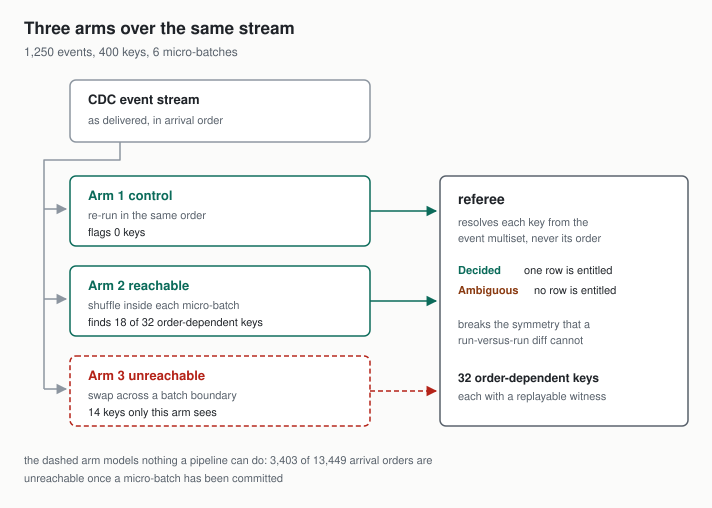
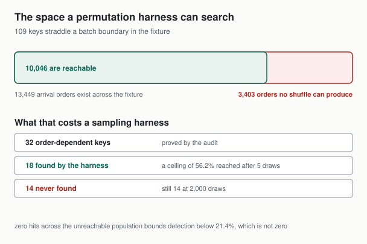
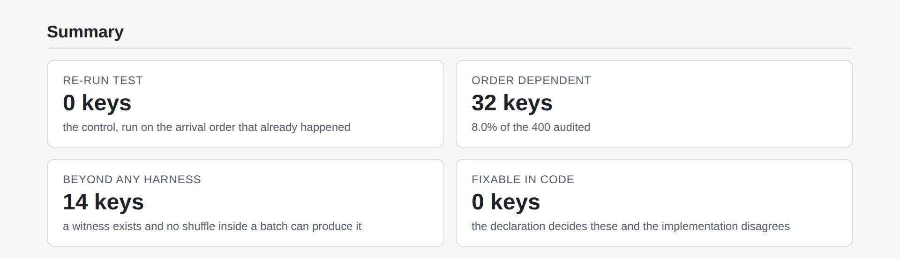
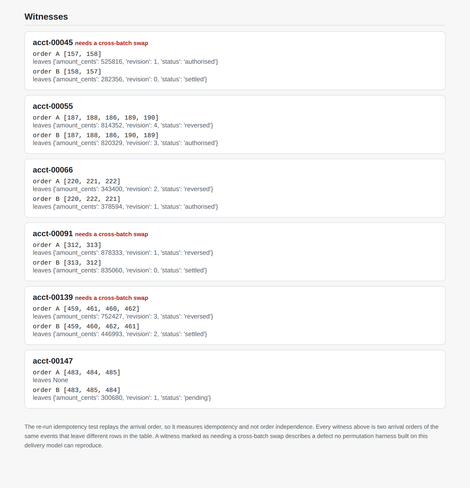

# merge-order-sensitivity

[](https://github.com/Sruthi0510-data/merge-order-sensitivity/actions/workflows/ci.yml)
[](https://www.python.org/)
[](#quickstart)
[](LICENSE)

**An auditor for lakehouse MERGE logic that reports which rows were chosen by delivery accident rather than by your sequence column, and which of those no test you could write will ever catch.**

## The question a re-run test cannot answer

The standard correctness check for a MERGE is to run the batch again and assert the table is unchanged. That check replays the arrival order. Order sensitivity is a property of varying the arrival order. Idempotency and order independence are different properties, and the test everybody writes only measures the first one.

Four questions this answers that the re-run test structurally cannot:

1. Which keys hold a row that would be different if the same events had arrived in a different order.
2. For each of those, whether the fault is in the declaration, which ties and therefore entitles you to no row at all, or in the code, which flips on keys the declaration decides perfectly well.
3. Which of them a permutation harness could find if you built one, and which are beyond any harness because producing the other outcome would require moving an event into a micro-batch that has already been committed.
4. What the fix costs, counted in rows that change the day it lands.

## The uncomfortable numbers

On the committed fixture of 1,250 events, 400 primary keys and 6 micro-batches:

- The re-run idempotency test **flags 0 keys**. It flags 0 keys for the worst implementation in the set too, the one that is **wrong on 325 keys** of 400.
- The audit proves **32 order-dependent** keys, **8.0% of keys** in the fixture. A permutation harness is the honest competitor to this tool, and it **finds 18 of** them. That is a **ceiling of 56.2%**, reached **after 5 draws** and unchanged **at 2,000 draws**. The remaining **14 of those keys** are not a budget problem.
- Zero hits across that unreachable population bounds the harness detection rate **below 21.4%** at 95% confidence, not at zero. A measured zero is a sample size, not a fact.
- Declaring a total order removes every finding and **rewrites 9 rows**, which is the migration nobody budgets for.

337 tests, 100.0% line and 100.0% branch coverage, and every figure on this page is re-measured by CI and matched against the wording around it by `tools/check_numbers.py`.

## Quickstart

Requires Python 3.11 or newer and nothing else. No API key, no cloud credentials, no network at runtime.

```bash
git clone https://github.com/Sruthi0510-data/merge-order-sensitivity.git
cd merge-order-sensitivity
pip install -e ".[dev]"

# the headline number, against the declaration in specs/payments.toml
mos audit --fixture fixtures/cdc_events.jsonl --spec specs/payments.toml

# what a permutation harness would have found instead
mos harness --draws 20

# the two arrival orders behind one finding, replayable by hand
mos witness acct-00045

# re-measure everything on this page and fail if a sentence has gone stale
make verify
```



## The declaration is a file, not a flag

The audit needs you to state which event wins. It reads that from a TOML file rather than only
from a flag, because a declaration nobody reviewed is the defect this repository is about, and a
flag leaves no record for a colleague to disagree with.

```toml
# specs/payments.toml
ordering = ["seq"]        # partial: one commit LSN can cover several rows
delete_wins_ties = false  # a partial fix that resolves nothing between two upserts
```

Unknown keys are refused rather than ignored, so a typo in a reviewed file cannot quietly mean
the default. A spec file combined with `--order-by` is refused too: two sources for one
declaration is how a team ends up auditing something other than what it reviewed.

## The two defect classes have different fixes

An audit that reports "this key is order dependent" is not actionable. There are two ways to get there and they need different work.

| implementation | order-dependent keys | declaration at fault | code at fault | re-run flags |
| --- | --- | --- | --- | --- |
| `arrival-lww` | 325 | 32 | 293 | 0 |
| `dedupe-first-max` | 32 | 32 | 0 | 0 |
| `dedupe-last-max` | 32 | 32 | 0 | 0 |
| `delete-wins` | 25 | 32 | 0 | 0 |
| `total-order` | 0 | 32 | 0 | 0 |

The **293 keys the declaration** decides and `arrival-lww` still gets wrong are the fixable class: the sequence column already says which event is later and the code never reads it. No tie is involved, which is why a review that starts by hunting for duplicate sequence numbers walks straight past them.

The 32 keys where the declaration itself ties are a different problem. No implementation can be correct about them, because there is nothing to be correct about. `dedupe-first-max` and `dedupe-last-max` are the two ways a Spark `row_number() over (partition by key order by seq desc) = 1` resolves such a tie, and which one a job gets is a property of the physical plan rather than of the query. They **disagree on 32 rows** of this fixture, silently, today.

`delete-wins` is the partial fix that looks complete. Letting a tombstone beat a concurrent upsert **leaves 25 keys** still order dependent, because it resolves nothing between two upserts.

## What a permutation harness can and cannot reach



A micro-batch is the unit of delivery. Once batch seven has been committed, no retry, no reader parallelism and no consumer rebalance can place one of its events after an event from batch eight. So the orders a real pipeline can produce are the product of the per-batch factorials, not the factorial of the group.

In this fixture **109 keys straddle** a batch boundary. Across all keys there are **13,449 arrival orders**, of which **10,046 are reachable** and **3,403 orders no** shuffle can produce. Every order-dependent key whose witness lives in that gap is invisible to a harness built on a real pipeline, at any budget.

| harness draws | detected | missed |
| --- | --- | --- |
| 1 | 10 | 22 |
| 5 | 18 | 14 |
| 2,000 | 18 | 14 |

A single **draw finds 10 keys** and **misses 22 of them**. Five draws reach eighteen. Four hundred times that budget reaches eighteen.

This is the section to read twice. The gap is not sampling noise and more compute does not close it. It is the difference between the space the harness searches and the space the defect lives in.

### What that buys, against what it costs

| approach | finds | costs |
| --- | --- | --- |
| re-run idempotency test | nothing about order | one extra run of the batch |
| permutation harness | the reachable defects, saturating quickly | a full job run per draw |
| this audit | every order-dependent key, with a replayable witness | permutations per key rather than per batch, and a declaration you have to write down |

The audit's cost is the honest one: it needs you to state the merge semantics as an ordering, in a file, where it can be disagreed with. That is the part teams skip, and it is the part that makes the referee possible.

## The bugs the measurement found

**A tombstone tie the fixture could not produce.** `delete-wins` measured as identical to the implementation it was meant to improve on, which read as evidence that the tombstone rule does nothing. It was not. The generator placed a sequence tie at a uniformly random position while a tombstone only ever landed at the last one, so a tie containing a tombstone needed both draws to coincide and the shipped fixture contained none. The implementation whose only purpose is resolving that tie was never once exercised. This is the repository's own argument one level up: a run that finds no difference cannot say whether the fix does nothing or the fixture never asked. A `tombstone_tie_rate` knob forces the case, a test asserts the shipped fixture contains it, and `delete-wins` now **leaves 25 keys** where the naive reading leaves 32.

**A referee that collapsed silently.** The first draft of the event model stored the payload as a dict on a frozen dataclass. Construction worked, equality worked, and the moment the referee put events into a set to count distinct outcomes it raised a `TypeError` from inside a comprehension three frames down. Freezing the payload into a tuple of sorted items at construction fixes it, and a test now asserts events are hashable.

**A rendering check that was wrong about a correct diagram.** The first version of `tools/verify_rendering.py` built its page with Playwright's `set_content`, whose `about:blank` origin cannot read local files, so both committed SVGs reported a `naturalWidth` of 0. The diagrams were fine. Writing a real HTML file next to them and navigating to it fixed the test rather than the artwork, and the story is in that tool's docstring so the next person does not spend the afternoon on it.

## Evidence

The report below is the tool's own HTML output, not a mockup. `tools/capture_screenshots.py` builds the report if it is missing, scrolls to a named heading, clips to the next one, and writes `docs/img/manifest.json` recording which headings framed each image. It also reads the computed style of the verdict badge back out of the rendered page and fails the run when the badge is invisible, because a badge class colliding with a table cell class at equal specificity renders the headline in its own background colour, and a screenshot tool is the only thing in the pipeline that can see pixels.





Every witness is replayable. A test takes each one from the shipped audit, replays both orders through the implementation, and asserts the two rows differ, so a witness in the report cannot be a rendering artefact.

Regenerate all of it with `make report && make screenshots`.

## The fixture

Generated by a seeded generator, committed, and regenerable byte for byte with `mos generate --seed 20260930`. It contains 1,250 events over 400 primary keys across 6 micro-batches, and it is built to contain the awkward cases rather than the easy ones:

- keys whose events all sit inside one batch, and **109 keys straddle** two or more;
- genuine sequence ties between two upserts, which no tie policy resolves;
- ties between an upsert and a tombstone, which a tombstone rule does resolve, present because their absence was a bug;
- ties where the tied events assert **identical** rows, which are not findings and must not be reported as such;
- keys with a single event, which every arm must leave alone.

A fixture of obviously-easy cases measures nothing, so saying which hard cases are in it is what makes the rates above believable.

## What this repository cannot measure

Its own section, because it is the most important one.

- **Nothing here runs Spark.** The implementations are faithful models of two `row_number` tie resolutions, not the resolutions themselves. The claim that survives the fixture is that both readings are legitimate and disagree; the claim that would need a real cluster is which reading a given physical plan produces. See ADR-003.
- **The unreachable arm is a statement about this delivery model.** It assumes micro-batches commit in order and an event cannot migrate between them. A pipeline with overlapping batches, or an at-least-once source that redelivers an old batch wholesale, has a larger reachable space and a smaller blind spot. The audit does not detect which model you are in; you declare it.
- **Key independence is verified, not assumed.** The audit permutes one key's events at a time, which is only equivalent to permuting the whole stream if no implementation lets one key influence another. All five bundled implementations satisfy that, and a test asserts it on the shipped fixture. A user-supplied implementation might not, and the audit would then under-report.
- **A sampled search proves nothing negative.** Above seven events per key the search samples rather than enumerates, and every finding records whether its search was exhaustive. A stable verdict from a sampled search is an absence of evidence and the JSON says so.
- **The referee can only be as right as the declaration.** It resolves keys from the event multiset under the ordering you give it. If that ordering is wrong about your business, the referee will be confidently wrong in exactly the same way, and no amount of permuting will reveal it.

## Layout, exit codes and reproduction

```
src/mos/
  events.py          the change event, arrival index and batch
  semantics.py       the referee: Decided, or Ambiguous
  implementations.py the five merges under audit
  permute.py         reachable orders against orders that merely exist
  audit.py           the three arms and the finding set
  detection.py       draws needed, and the rule of three
  generator.py       the seeded fixture generator
  delta.py           optional: write an audited table to Delta
specs/               the merge declaration, as a reviewable TOML file
experiments/         five experiments, each writing JSON to docs/experiments/
tools/               metrics collection, number checking, diagrams, rendering
docs/adr/            five architecture decision records
```

| code | meaning |
| --- | --- |
| 0 | the audit ran and found no order-dependent keys |
| 3 | the audit ran and found some. This is the tool working |
| 2 | the tool could not answer: bad arguments, unreadable fixture, contradictory spec |
| 4 | the audit ran but the permutation budget cannot support the confidence requested |

The separation of 0 from 3 is the one that matters operationally. A CI step treating every non-zero code as a crash reports a genuine finding as a broken tool, and the fix a team reaches for is to stop running the tool.

```
make lint       ruff over src, tests, tools and experiments
make test       pytest with junit and coverage reports
make receipts   re-measure every published figure and check it against the prose
make verify     all of the above, offline, from a fresh clone
```

`tools/check_numbers.py` matches anchor phrases rather than bare digits, because searching for digits passes happily while the sentence around them has gone stale. It collapses whitespace first so an anchor whose words straddle a wrapped line cannot fail correct prose, and it checks backwards as well: any number in this README that no metric explains is reported as unguarded.

## Tech stack

| technology | role here | why this one |
| --- | --- | --- |
| Python, standard library only | the whole audit engine | the core is permutation and comparison; a dependency would have to earn its place and none did |
| pytest with coverage | 337 tests, at 100.0% line and 100.0% branch | branch coverage is the one that matters for a module full of tie-breaking conditionals |
| ruff | lint and import order | one tool over source, tests, tooling and experiments, so the experiments cannot drift into scratch code |
| deltalake, optional extra | writing an audited table to a real Delta table | proves a witness produces two different Delta tables rather than two different Python dicts, without a JVM |
| Playwright with Chromium | asserting the committed SVGs load as images | only a browser can see a `naturalWidth` of 0, so only a browser can check it |
| hand-emitted SVG | the two diagrams | avoids four Mermaid failure modes that all land on a README embed. See ADR-002 |

## Architecture decision records

- ADR-001: the referee is a third implementation, not a second opinion
- ADR-002: batch boundaries bound the search, and that bound is the product
- ADR-003: no Spark in the default path
- ADR-004: exit codes separate a finding from a failure
- ADR-005: what this repository cannot measure, and what it would take

## The Pivot

Cross-batch witnesses are reported and not repaired. The audit can prove a key is order dependent in a way no shuffle reaches, and it stops there rather than proposing a reordering of the committed log, because rewriting delivery history is a much larger change than the one this tool is arguing for. The trigger for building it: a pipeline where the cross-batch population is the majority rather than **14 of those keys**, at which point the declaration is the wrong tool and the delivery model needs the attention instead.

## Future work

- A pyspark extra that runs the same audit against real `row_number` output, to settle which reading a given physical plan produces. First metric to watch: whether the real plan ever disagrees with both bundled readings.
- Column-level findings rather than row-level, so a key whose only order-dependent field is a non-material timestamp can be ranked below one whose amount moves.
- A CI mode that fails only on new findings against a committed baseline, since a repository-wide gate on an existing pipeline gets disabled on day one.
- Support for a declared ordering that is partial by design, where ambiguity is the intended semantics and the useful output is the set of keys where it actually bites.

## Licence

MIT. See `LICENSE`.
